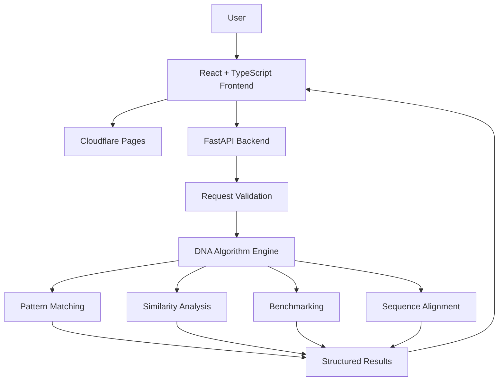

# 🧬 DNA-SSSA — DNA Sequence Search & Similarity Analyzer

  <strong>A bioinformatics platform for DNA pattern discovery, sequence similarity analysis, and algorithmic benchmarking.</strong>

  🌐 <a href="https://dna-sssa.pages.dev">Explore the Live Application</a>

---

## Overview

DNA-SSSA is a full-stack bioinformatics application designed to make DNA sequence analysis accessible through efficient pattern matching, sequence similarity computation, and algorithmic performance evaluation.

The platform provides an interactive environment where users can search nucleotide patterns, compare DNA sequences, visualize algorithm performance, and explore classical computational techniques used in biological sequence processing.

The core algorithms are implemented from scratch in pure Python, emphasizing algorithmic transparency, efficiency, and practical usability.

## ✨ Features

- **DNA Pattern Search** — Locate nucleotide patterns using multiple string-matching algorithms.
- **Multi-Pattern Search** — Search for multiple DNA patterns within a sequence.
- **Sequence Similarity Analysis** — Compare DNA sequences and analyze their differences.
- **Algorithm Benchmarking** — Evaluate and compare algorithm execution performance.
- **FASTA Support** — Upload and analyze DNA sequences in FASTA format.
- **Random Sequence Generation** — Generate DNA sequences for experimentation.
- **Interactive Visualization** — Explore search results and benchmark comparisons.
- **Reverse Strand Search** — Support searching across both DNA strands.

## 🧠 Algorithms

| Algorithm | Description |
|---|---|
| Naive String Matching | Direct character-by-character pattern search |
| Knuth-Morris-Pratt (KMP) | Efficient pattern matching using the LPS array |
| Rabin-Karp | Pattern matching using rolling hash |
| Boyer-Moore | Optimized matching using character-based heuristics |
| Z-Algorithm | Pattern matching using the Z-array |
| Multi-Pattern Matching | Simultaneous discovery of multiple patterns |
| Levenshtein Distance | Computes the minimum edit distance between sequences |
| Longest Common Subsequence (LCS) | Identifies the longest common subsequence |

## 🛠️ Technology Stack

### Frontend
- React
- TypeScript
- Vite
- Tailwind CSS
- Recharts

### Backend
- Python
- FastAPI
- Uvicorn
- Pydantic

### Testing & Deployment
- pytest
- Git
- GitHub
- Cloudflare Pages
- Render

## 🏗️ Architecture

## 🎯 Purpose

DNA-SSSA aims to simplify DNA sequence analysis by bringing multiple computational techniques together in a single interactive platform.

It provides an environment for exploring nucleotide patterns, studying sequence similarities, and understanding the performance characteristics of different algorithms.

## 🔮 Future Scope

- Advanced biological motif discovery
- Support for large-scale genomic datasets
- Improved sequence alignment strategies
- Additional pattern-matching optimizations
- Enhanced DNA sequence visualization
- Integration with public genomic data sources
- Expanded benchmarking and analytical capabilities

## 🤝 Contributions

Suggestions, improvements, and contributions are welcome.

Feel free to report issues, propose enhancements, or contribute to the development of DNA-SSSA.

---

  <strong>By - Tanmay Pratap Singh</strong> 
  Making DNA sequence analysis more accessible through algorithmic computing.

